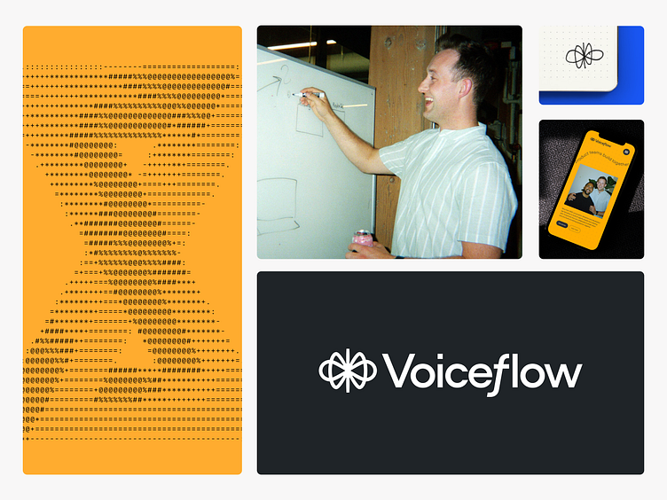
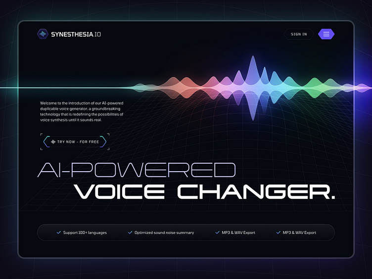
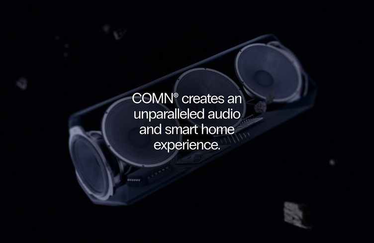

# Research references and visual credits

Retrieved 26 October 2026 using Agent Reach: Exa discovery, Jina page reading, then public image URLs exposed by those pages. Local reference images below were visually inspected. These are research evidence, not licensed production assets. Do not ship them with the website; production artwork is newly created under the other asset folders.

## Voiceflow — scalable identity

[Voiceflow Rebrand + Case Study](https://dribbble.com/shots/23864434-Voiceflow-Rebrand-Case-Study), **Focus Lab + Odi**.

Observed: a compact symbol works next to a large wordmark, with applications across a phone, monochrome lockup and orange portrait artwork. Adopt a consistent symbol/lockup family and restrained typography. Do not copy the flower-like symbol, colors, portrait or the Voiceflow name. The page describes a brand strategy/verbal/visual identity engagement; this is an identity reference, not a dictation accuracy comparison.

Original image: [creator's Dribbble image](https://cdn.dribbble.com/userupload/13687756/file/original-86f5b5634ebe9b874cef0e35e5197ef5.png?resize=752x&vertical=center).

## SLAB — sound carries the hero

[Voice Generator Landing Page](https://dribbble.com/shots/22183825-Voice-Generator-Landing-Page), **Aryo Pamungkas for SLAB Design Studio**.

Observed: the waveform is the primary graphic, a strong typographic anchor sits below it, and actions remain distinct. Adopt an audio-led central image and clear action hierarchy. Reject the dark neon spectrum, sci-fi grid, tiny technical decoration and feature/performance claims for this light-first Android app. The reference is voice generation; Local Voice is dictation.

Original image: [creator's Dribbble image](https://cdn.dribbble.com/userupload/9063067/file/original-68eedd3190f52a499c92dad5b18abacb.jpg?resize=752x&vertical=center).

## Zajno — dimensional audio imagery

[Loudspeaker Landing Page Concept](https://dribbble.com/shots/22346222-Loudspeaker-Landing-Page-Concept), **Daniel for Zajno**.

Observed: one large dimensional speaker occupies the composition; a concise block of copy floats with generous space. The creator describes video, levitation and a multi-room experience. Adopt depth and clear visual focus in the new glass-capsule illustration. Do not reuse the speaker image, dark palette, product branding or imply that our still image is an observed animation. Only this still and the written description were reviewed.

Original image: [creator's Dribbble image](https://cdn.dribbble.com/userupload/9493964/file/original-edc19853ef16d707b691368420ec9ca8.jpg?resize=752x&vertical=center).

## Voxworks — motion states

[Voxworks Website Animation](https://contra.com/p/lMvYBE3W-voxworks-website-animation), **David Akanbi**.

The creator's walkthrough describes a Rive concept with an idle coin/wave state and a faster hover response. Adopt state-aware motion and settling feedback rather than decorative motion everywhere. Do not copy the coin, VX logo, animation file or claim that video playback was tested: this reference was read as text, not played. Local Voice's waveform loop is independently authored and demonstrative, not live microphone data.

## Wispr Flow — product explanation

[Wispr Flow](https://wisprflow.ai/), **Wispr**.

The current page leads with speaking instead of typing and explains polished writing across apps. Adopt concise product explanation and a concrete speech-to-text example. Do not import speed multipliers, customer logos, testimonials, naming, visual assets or claims of feature parity. Local Voice uses local speech models and a rule-based formatter; it does not reproduce Flow's cloud rewrite pipeline. See the existing `docs/WISPR_FLOW_FORMATTING_RESEARCH.md` for the earlier technical comparison.

## Font source

[Manrope in Google Fonts](https://github.com/google/fonts/tree/main/ofl/manrope). Self-hosted font and original OFL license are supplied. Use real text for page copy and path outlines for the logo.

## Evidence boundaries

The first in-app browser attempt to load Dribbble timed out. Agent Reach's Jina backend returned the pages and image URLs; the three local images above were opened and inspected directly. The reference board summarizes those stills. No third-party animation playback, live site interaction/performance audit, trademark clearance or legal-policy review is implied. The new website layout study and brand board are original static design artifacts, not screenshots of a deployed website.
