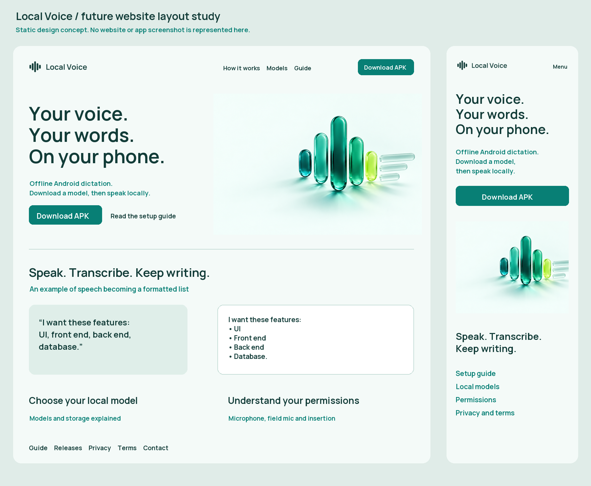
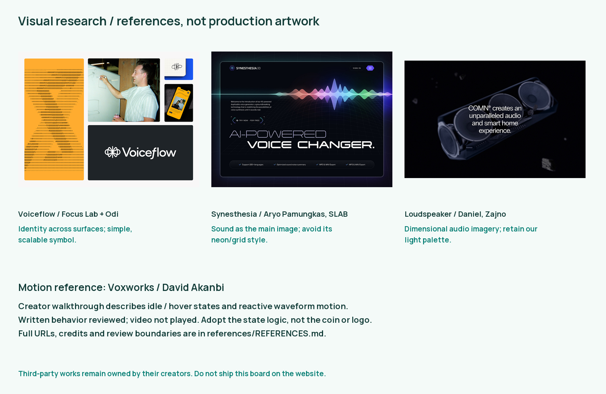

# Local Voice — website design and asset handoff

26 October 2026. Design specification only. **No Next.js project, website, deployment or public download page has been created.**

## Product and purpose

Local Voice is an Android app for offline dictation, local transcription formatting and guarded insertion into a focused text field. The first website should explain how it works, help someone install the correct APK and model, describe permissions clearly, and provide usage and privacy information. The key difference to communicate is processing on the phone after an explicit model download. Do not present this app as affiliated with Wispr Flow or Handy.

The existing temporary Local Voice name is retained. The new identity is a five-stroke sound mark, bright teal with a small citron note, and calm porcelain surfaces. It extends the light-first app direction without redesigning its settings or recording UX in this release.

## Visual direction






The memorable moment is speech turning into clean written lines. Let that movement occupy one part of the hero while the headline and install action stay still. The rest of the page uses honest product explanations and spacious typography. Avoid a wall of identical rounded feature cards, dark neon grids, invented counters, fake testimonials or a looping animation on every section.

### Color and type

| Token     | Value     | Use                                        |
| --------- | --------- | ------------------------------------------ |
| Porcelain | `#F4FAF8` | Main surface                               |
| Forest    | `#123C38` | Headings/body, dark section background     |
| Teal      | `#087F75` | Buttons, active controls, waveform         |
| Citron    | `#DAF975` | Single accent, highlights with forest text |
| Mint      | `#C5DDD7` | Diagram lines, borders, quiet fills        |
| White     | `#FFFFFF` | Phone/paper planes, text on dark           |

Use Manrope variable, supplied locally under OFL: body 450, headings 650, actions 650. Desktop headline 64–76 px / 1.05, tablet 52 px, mobile 40–44 px; section headings 36–44 / 1.15, body 18 / 1.6, small metadata 14 / 1.5. Body columns 58–68 characters. Do not use citron text on light surfaces. Validate contrast in the eventual implementation, including hover, muted copy, focus rings and disabled states; text must meet WCAG AA.

Use an 8 px underlying rhythm with 4/8/12/16/24/32/48/64/96/128 spacing. Desktop page max-width 1200 px, gutters 40 px; mobile gutters 20 px, with 48–64 px section gaps. Controls 12 px corners, illustrations 24 px, device frames 40 px. Text itself should not be put inside unnecessary cards. Align body copy and actions left.

### Desktop composition

```text
Logo                        How it works   Models   Guide     Download APK
------------------------------------------------------------------------
Your voice. Your words.          Dimensional sound-to-text illustration
On your phone.                  with generous negative space
Offline Android dictation.
[Download for Android] [See setup]
Android version • APK size • version/date • SHA-256 details
------------------------------------------------------------------------
Speak -> transcribe locally -> insert into your field (interactive demo)
------------------------------------------------------------------------
One real recording flow / side-by-side raw and formatted text example
------------------------------------------------------------------------
Choose a local model             Why permissions are needed
------------------------------------------------------------------------
History and recording choices    Practical limitations and FAQ
------------------------------------------------------------------------
Download / release notes / usage guide / privacy / terms / contact
```

On mobile, navigation becomes a keyboard-accessible disclosure; headline/action precede the hero image, the demo stacks vertically, model comparison becomes labeled rows, and the download button never hides policy/setup information. No horizontal scrolling at 320 px; no sticky CTA covering content or consent controls.

## Motion, with a purpose

Motion research includes the [Voxworks Rive animation case study](https://contra.com/p/lMvYBE3W-voxworks-website-animation): the creator describes idle versus hover states and a waveform response. The principle to adopt is a meaningful state change, not its specific coin, logo or infinite rotation.

| State            | Behavior                                                                              | Timing                                     |
| ---------------- | ------------------------------------------------------------------------------------- | ------------------------------------------ |
| Initial hero     | One restrained reveal of waveform then text lines; heading remains stable             | 600–900 ms, once                           |
| Demo idle        | Static waveform and explicit “Play example” control                                   | No automatic audio                         |
| Demo playing     | Five strokes respond to a supplied, prerecorded envelope, then settle into text lines | Example length; never fake live mic access |
| Action/accordion | Color/opacity or short translate feedback                                             | 160–240 ms                                 |
| Reduced motion   | Static illustration, completed text, no loop or scroll effects                        | Immediate                                  |

The supplied SVG/WebP loop is illustrative decoration. Label it as an example when used in a demo. Do not claim it is reacting to microphone input. Prefer CSS/SVG transforms to a new animation dependency for five bars. Pause looping assets when out of view or page hidden, provide a pause control for motion continuing longer than five seconds, and use a static source for `prefers-reduced-motion`. Do not autoplay sound. If a future real recorder demo is added, it needs its own permission/privacy design; it is out of current scope.

## Content and routes for the later build

| Proposed route | Required content                                                                                                                                     |
| -------------- | ---------------------------------------------------------------------------------------------------------------------------------------------------- |
| `/`            | Product explanation, setup action, truthful demo, key features and limits                                                                            |
| `/download`    | Release APK, ARM64 requirement, Android minimum, size, version, checksum, certificate fingerprint and setup link                                     |
| `/guide`       | Install, download a model, language modes, mic/accessibility/overlay setup, field mic, Stop/Cancel, formatting, history and playback                 |
| `/models`      | Pinned model names/download sizes, language support, local storage needs, accuracy/speed tradeoffs without invented scores                           |
| `/releases`    | Dated changes, known issues, signing/package transition                                                                                              |
| `/privacy`     | Actual app data flow and separate website practices, owner/contact, effective date, deletion/export, model download network behavior                 |
| `/terms`       | Publisher identity/contact, app scope, licenses/attribution, acceptable use, support/update/distribution terms, applicable details supplied by owner |

These are a content inventory, not completed legal policies. Confirm publisher/contact and future website hosting/analytics/cookies before publishing policy text. Do not invent a business entity, jurisdiction, warranty or claim of legal compliance.

Suggested hero copy: “Your voice. Your words. On your phone.” Supporting copy: “Dictate into Android text fields with speech recognition running locally after you download a model.” Primary action: “Download APK.” Secondary: “Read the setup guide.” Show the current release version and actual byte size from build metadata rather than hardcoded marketing numbers.

Useful guide example: “I want these features: UI, front end, back end, database.” Show the current rule-based formatter's actual output. Label it as an example, not a benchmark. Explain that model recognition can make mistakes and Hindi/Roman Hindi quality varies. Do not claim Flow-equivalent generative rewriting, unlimited recording, universal editor support or verified performance on untested phones.

The app uses microphone access for recording, overlay/accessibility for the optional field mic and insertion, and Internet access for explicit model downloads. Android may restrict sideloaded app accessibility access; release signing does not remove platform restrictions. Use the existing app's help text as the factual starting point.

History and recording retention are opt-in, audio/text are encrypted locally, metadata is separate, export creates user-controlled files, and automatic pruning happens at app startup. Explain exactly what the shipped version does rather than promising all storage is encrypted or immediate background deletion. Optional BYOK cloud text cleanup is off by default, requires consent, and sends transcript text only to the selected provider; there is no cloud speech recognition or account. The website has separate hosting logs; do not use an unqualified “no data ever leaves your device” claim.

## Next.js handoff, without implementation

Use the assets under a future `public/brand/` directory, excluding `references/` and `previews/`. Use the path-based wordmark SVG so fonts do not affect logo layout. Serve Manrope WOFF2 through a local font loader. Keep headings as HTML; no text baked into the hero image. Use responsive image sizes, explicit dimensions and appropriate alt text. The hero can be decorative (`alt=""`) when the adjacent paragraph conveys its meaning. Explain diagrams in surrounding text.

Prefer mostly static routes and server-rendered content. The only initial client interactions needed are the navigation disclosure, FAQ and optional prerecorded demo. No microphone permission should be requested by the landing page. Keep download links same-origin or clearly identify the distribution host. Do not add trackers or cookies without a separate product decision and matching disclosure.

Target: mobile hero image under 200 KB, desktop hero under 300 KB, self-hosted WOFF2 under 150 KB where possible. Measure real exported files before implementation; do not claim performance scores now. Avoid shipping the PNG master or third-party references to clients. Provide accessible download names, visible focus, 44 px minimum interactive targets and a useful static page with JavaScript disabled. Test layout at 320/390/768/1024/1440 px.

## Research and visual attribution

The [reference index](../assets/brand/references/REFERENCES.md) lists the sources, creator credits, retrieved visual evidence and specific decisions. Agent Reach used Exa for discovery and Jina for source pages. Three Dribbble shot images were retrieved and visually inspected. Browser access to the first Dribbble page timed out; page text/images were available through Jina and the linked public CDN. The Voxworks motion behavior is based on the creator's written walkthrough; its animation was not played or frame-verified. The original identity is not a reproduction of any reference.

## Acceptance for the future website

- Show an installable, correctly labeled release download with verified checksum; preserve signing identity for updates.
- Supply a complete usage guide, truthful model/storage guidance, permission help and known limits.
- Publish owner-reviewed privacy/terms pages using actual publisher and hosting facts.
- Use original production assets only; keep creator-owned research out of deploy output.
- Check all responsive breakpoints, keyboard navigation, contrast, reduced motion, image budgets and working links.
- Replace any future mock product demonstration with current app captures before calling it an app screenshot.
